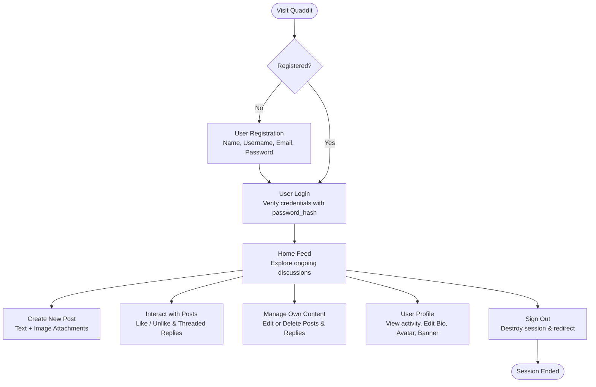

# Quaddit — Forum & Discussion Board

> A lightweight, dynamic web-based discussion board built with **PHP** and **MySQL**, designed to let students and campus members start discussions, share ideas, attach images, reply to threads, and connect with their community.

---

## 📌 Project Overview

**Quaddit** is a dynamic web application created as a **PHP Mini Project (PCA 2, 5th Semester)** at **Bhawanipur Global Campus** under the guidance of **Prof. Majid Malik**.

The primary purpose of this project was to gain practical, hands-on experience in building a complete end-to-end dynamic web application from scratch — integrating frontend interfaces, server-side processing, session management, secure user authentication, and relational database management.

### Key Highlights
- **Interactive Discussions**: Create discussion threads with formatted text and image attachments.
- **Engaging Community**: Browse the central home feed, reply to ongoing discussions, and react with likes.
- **Content Management**: Users have full control to edit or delete their own posts and replies.
- **Personalized Profiles**: View user profiles, activity history (posts and replies tabs), and customize bios, profile avatars, and header banners.
- **Built-in Security**: Passwords are securely hashed with PHP's native `password_hash()` and verified using `password_verify()`.

---

## 🛠️ Technology Stack

The project relies on a clean, dependency-free tech stack with zero heavy external frameworks:

| Layer | Technology | Purpose |
|---|---|---|
| **Frontend** | **HTML5** | Semantic structure for pages, forms, buttons, and navigation |
| | **CSS3** | Responsive layout styling, colors, dark/light themes, typography, and card designs |
| | **Vanilla JavaScript** | Client-side interactions, modal popups, live image previews, and theme toggling |
| **Backend** | **PHP** | Server-side logic, routing, request processing, authentication, and database queries |
| **Database** | **MySQL** | Relational storage for user accounts, posts, images, replies, and likes |
| **Environment** | **Apache & XAMPP** | Local development environment and web server execution |
| **DB Management** | **phpMyAdmin** | Database administration, table structuring, and record inspection |

---

## 🏗️ System Architecture

Quaddit follows a classic **3-Tier Client-Server Architecture**:

```
┌────────────────────────────────────────────────────────┐
│               1. Presentation Layer (Frontend)         │
│          HTML5  •  CSS3  •  Vanilla JavaScript         │
│  (Desktop Browser, Mobile Layout, Responsive Design)   │
└───────────────────────────┬────────────────────────────┘
                            │ HTTP Requests / Responses
                            ▼
┌────────────────────────────────────────────────────────┐
│               2. Application Layer (Backend)           │
│                 PHP  •  Apache Web Server              │
│  (Auth, Sessions, Post/Reply Handlers, Image Encoding) │
└───────────────────────────┬────────────────────────────┘
                            │ SQL Queries (MySQLi)
                            ▼
┌────────────────────────────────────────────────────────┐
│               3. Database Layer (Storage)              │
│                         MySQL                          │
│     (users, posts, post_images, replies, likes)        │
└────────────────────────────────────────────────────────┘
```

1. **Client Side (Front End)**: The visual interface where users interact with the forum — browsing discussion feeds, filling out forms, viewing media, and toggling themes.
2. **Server Side (Back End)**: PHP processes incoming HTTP requests, enforces access control via PHP sessions, executes database interactions, and renders dynamic responses.
3. **Database Layer**: MySQL reliably stores and organizes all application data, linking records together through unique primary and foreign keys.

---

## 🔄 User Workflow



---

## 🗄️ Database Design

The relational database (`Quaddit`) is designed with interconnected tables using primary (`PK`) and foreign keys (`FK`):

```
 ┌──────────────────────┐         1:N         ┌──────────────────────┐
 │        users         │────────────────────<│        posts         │
 ├──────────────────────┤                     ├──────────────────────┤
 │ PK  id               │                     │ PK  id               │
 │     username         │                     │ FK  user_id          │
 │     email            │                     │     title            │
 │     password (hash)  │                     │     content          │
 │     name             │                     │     created_at       │
 │     avatar           │                     │     updated_at       │
 │     banner_url       │                     └──────────┬───────────┘
 │     role             │                                │
 │     bio              │                                │ 1:N
 │     created_at       │                                ▼
 └──────────┬───────────┘                     ┌──────────────────────┐
            │                                 │     post_images      │
            │                                 ├──────────────────────┤
            │                                 │ PK  id               │
            │                                 │ FK  post_id          │
            │                                 │     image_url / data │
            │                                 │     created_at       │
            │                                 └──────────────────────┘
            │
            │ 1:N                             ┌──────────────────────┐
            ├────────────────────────────────<│       replies        │
            │                                 ├──────────────────────┤
            │                                 │ PK  id               │
            │                                 │ FK  post_id          │
            │                                 │ FK  user_id          │
            │                                 │ FK  parent_id (self) │
            │                                 │     content          │
            │                                 │     created_at       │
            │                                 └──────────────────────┘
            │
            │ 1:N                             ┌──────────────────────┐
            └────────────────────────────────<│        likes         │
                                              ├──────────────────────┤
                                              │ PK  id               │
                                              │ FK  user_id          │
                                              │ FK  post_id          │
                                              │     created_at       │
                                              └──────────────────────┘
```

- **`users`**: Stores account details, hashed passwords, display names, bios, avatars, and banner pictures.
- **`posts`**: Stores discussion titles, body text, timestamps, and the author's user ID.
- **`post_images`**: Stores attached image data linked to their respective discussion post.
- **`replies`**: Stores comments and replies linked to specific posts, with `parent_id` support for threaded conversations.
- **`likes`**: Tracks likes on posts, ensuring each user can like or unlike individual discussions.

---

## ✨ Features Implemented

### 1. User Registration & Secure Login
- Simple account creation with name, lowercase username, email, and password confirmation.
- Secure password hashing using PHP's native `password_hash()` and `password_verify()`.
- Session-based authentication protecting discussion and profile routes from unauthenticated access.

### 2. Main Discussion Feed
- A clean, centralized feed displaying recent discussions with author avatar, username, timestamps, and engagement counters (likes and replies).
- Fast navigation to inspect individual posts and browse the full discussion thread.
- Sidebar highlighting top recent discussions for quick discovery.

### 3. Create, Edit & Delete Posts
- Dedicated composer modal to draft posts with titles, descriptions, and up to 4 image attachments.
- Authors can edit their existing post content and manage attached images.
- Safe post deletion allowing authors to remove their discussions whenever needed (restricted to post owners).

### 4. Interactive Feedback & Replies
- Instant like/unlike toggle to give feedback on posts.
- Threaded conversation replies under each discussion post.

### 5. Profile & Customization
- Dedicated user profile pages showing user information, join date, and discussion stats.
- Tabbed interface separating user **Posts** and **Replies**.
- In-place profile editor allowing users to update their display name, bio, avatar, and profile banner with real-time client previews.

---

## 🚀 Getting Started (Local Setup)

To run Quaddit locally on your machine:

### Prerequisites
- [XAMPP](https://www.apachefriends.org/) (with **Apache** and **MySQL** modules).
- A modern web browser (Google Chrome, Microsoft Edge, Mozilla Firefox).

### Setup Instructions

1. **Clone or Copy the Project**:
   Place the project folder inside your XAMPP web root directory:
   ```
   C:\xampp\htdocs\FORUM-OR-DISCUSSION-BOARD
   ```

2. **Start Services in XAMPP Control Panel**:
   - Start **Apache** (runs on port `80`, `443`).
   - Start **MySQL** (runs on port `3306`).

3. **Import Database in phpMyAdmin**:
   - Open your browser and navigate to `http://localhost/phpmyadmin`.
   - Create a new database named **`Quaddit`**.
   - Create or import the required tables (`users`, `posts`, `post_images`, `replies`, `likes`).

4. **Verify Database Configuration**:
   The database connection settings are located in `db.php`:
   ```php
   $host   = '127.0.0.1';
   $dbname = 'Quaddit';
   $user   = 'root';
   $pass   = '';
   ```

5. **Launch the Application**:
   Open your browser and visit:
   ```
   http://localhost/FORUM-OR-DISCUSSION-BOARD/
   ```
   Register a new account or log in to start exploring Quaddit!

---

## 👥 Project Team & Credits

- **Aditya Biswas** — BCA - B (`adityabiswas.24@bhawanipurglobal.edu.in`)
- **Prithviraj Pati** — BCA - B (`prithvirajpati.24@bhawanipurglobal.edu.in`)

**Academic Institution**: Bhawanipur Global Campus, Kolkata  
**Subject**: PCA 2 — PHP Mini Project (5th Semester)  
**Project Guide**: Prof. Majid Malik  

---

## 🎓 Conclusion

Building Quaddit provided practical experience in bridging theoretical knowledge of web development into a working real-world application. Through this project, we strengthened our understanding of core PHP server-side programming, relational data modeling in MySQL, session-based security, and building clean, responsive user interfaces.

