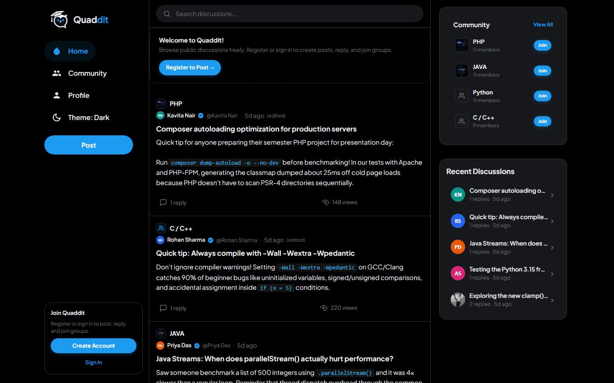
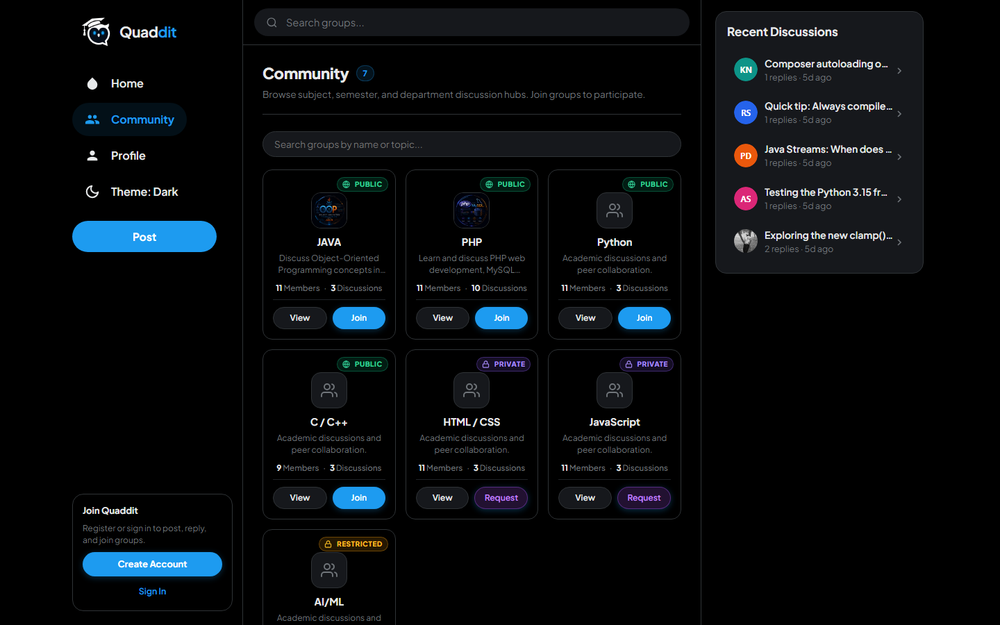
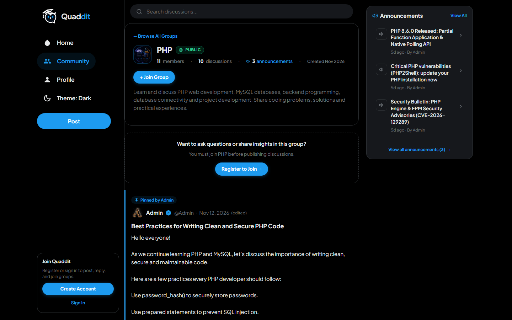
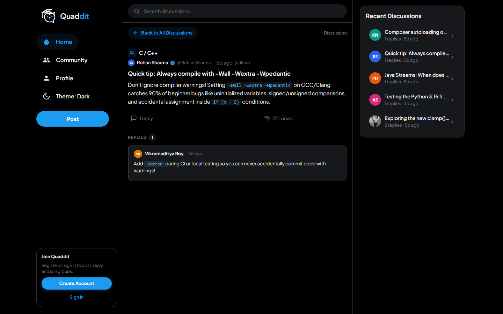
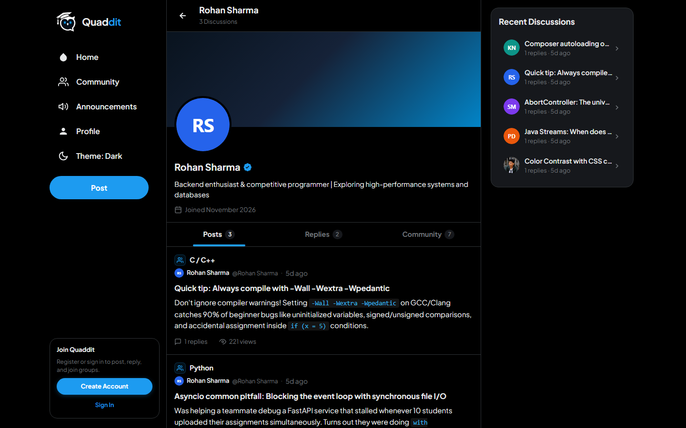
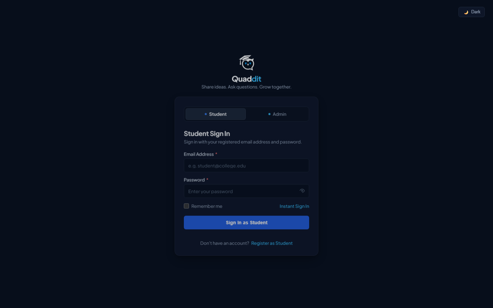
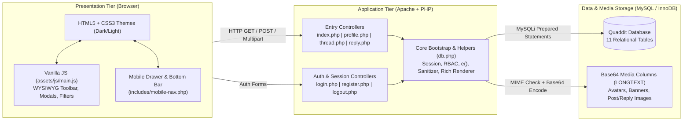
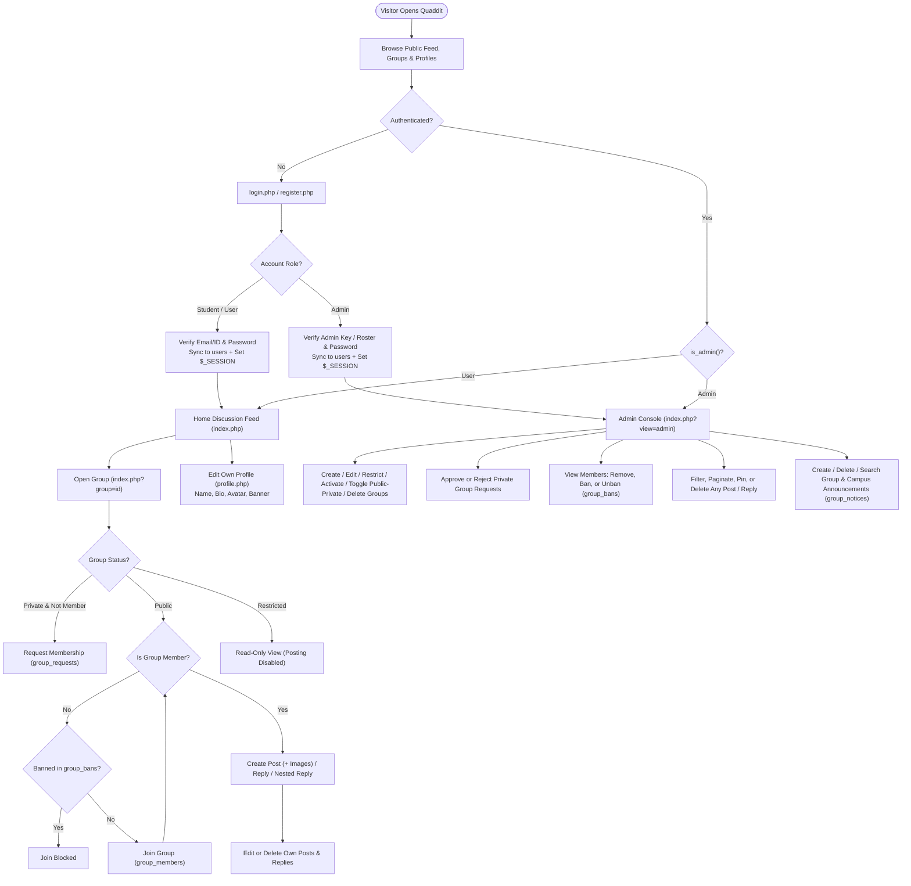
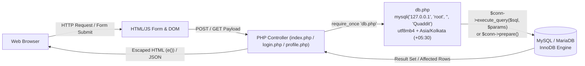
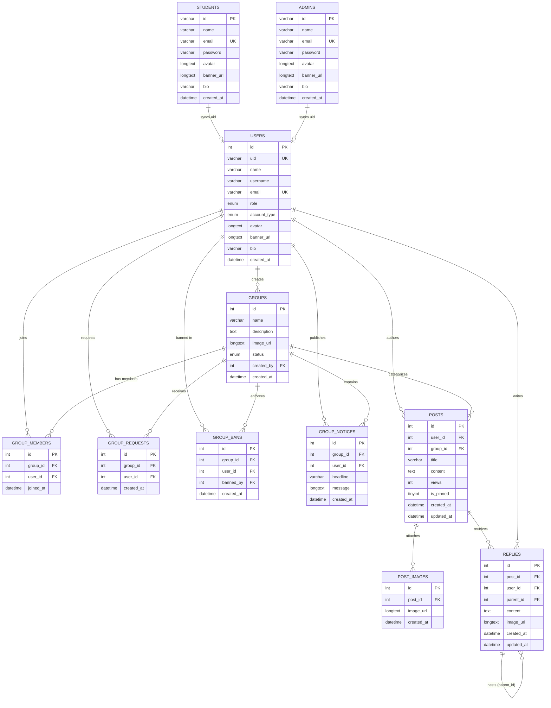

# Quaddit — College Discussion Board & Community Forum

**Quaddit** is a full-stack web forum and academic community platform built with **PHP**, **MySQL (MySQLi)**, **HTML5**, **CSS3**, and **Vanilla JavaScript**. It enables students, educators, and administrators to organize subject-specific discussion groups, publish rich-text threads with image attachments, collaborate through nested replies, manage group memberships and bans, and broadcast administrative announcements.

---

## Table of Contents

1. [Project Overview](#project-overview)
2. [Website Preview](#website-preview)
3. [Key Features](#key-features)
4. [User Features](#user-features)
5. [Admin Features](#admin-features)
6. [Technology Stack](#technology-stack)
7. [System Architecture](#system-architecture)
8. [Application Workflow](#application-workflow)
9. [Database Architecture](#database-architecture)
10. [Entity Relationship Diagram](#entity-relationship-diagram)
11. [Database Keys and Relationships](#database-keys-and-relationships)
12. [Project Folder Structure](#project-folder-structure)
13. [Installation and Setup](#installation-and-setup)
14. [Database Configuration](#database-configuration)
15. [How to Run the Project](#how-to-run-the-project)
16. [Security Considerations](#security-considerations)
17. [Future Improvements](#future-improvements)
18. [Contributors](#contributors)

---

## Project Overview

Quaddit uses a three-column desktop forum layout (navigation sidebar, central feed/thread workspace, and contextual right sidebar) paired with a sticky mobile top bar, bottom navigation bar, and slide-out drawer.

Key architectural characteristics observed directly in the codebase:

- **Zero external frameworks**: Pure procedural/modular PHP (`db.php`, `index.php`, `profile.php`, `login.php`, `register.php`) and dependency-free ES6+ JavaScript (`assets/js/main.js`).
- **Role-separated account tables bridged to a unified relational user table**: Registration and login store credentials in `students` or `admins`, while `login_user_session()` synchronizes the active account into `users` so posts, replies, memberships, bans, and announcements share clean foreign-key relationships.
- **Database-backed media**: Uploaded avatars, profile banners, group icons, post images, and reply images are converted server-side to Base64 data URIs and stored in `LONGTEXT` columns.

---

## Website Preview

All screenshots below were captured directly from the live local Quaddit instance (`http://127.0.0.1/FORUM-OR-DISCUSSION-BOARD/`).

> **Note:** Authenticated-only views (such as the Admin Console) are not pictured because unauthenticated access is blocked by server-side session and role checks (`is_admin()`).

|                                       Homepage Feed                                       |                                Community Groups Directory                                |
| :---------------------------------------------------------------------------------------: | :--------------------------------------------------------------------------------------: |
|                                     |                              |
| _Three-column layout with search bar, discussion feed, community widget, and dark theme._ | _Public, Private, and Restricted group cards with live search and join/request actions._ |

|                             Individual Group Discussion Page                             |                               Discussion Post & Reply Interface                               |
| :--------------------------------------------------------------------------------------: | :-------------------------------------------------------------------------------------------: |
|               |                   |
| _Group header, pinned posts, membership gating prompt, and group announcements sidebar._ | _Expanded discussion thread showing formatted inline code, view counter, and nested replies._ |

|                                    User Profile Page                                    |                                  Authentication Portal                                  |
| :-------------------------------------------------------------------------------------: | :-------------------------------------------------------------------------------------: |
|                           |                         |
| _Profile banner, avatar, bio, join date, and tabbed Posts / Replies / Community views._ | _Role-aware sign-in portal with Student and Admin tabs and password visibility toggle._ |

---

## Key Features

- **Topic-Based Communities**: Public, Private (approval-gated), and Restricted (read-only) discussion groups.
- **Rich-Text Editor & Markdown/HTML Rendering**: Visual `contenteditable` formatting toolbar (`Bold`, `Italic`, `Underline`, `Strikethrough`, `Heading`, `Bullet List`, `Link`) synced with hidden form fields and sanitized server-side in `db.php`.
- **Multi-Image Post & Reply Uploads**: Attach multiple images per discussion post (`post_images`) and single images on replies (`replies.image_url`) with client-side previews.
- **Recursive Nested Replies**: Hierarchical reply threads via self-referencing `replies.parent_id` with inline reply forms.
- **Group Moderation & Ban Enforcement**: Per-group bans (`group_bans`), member removal, and private group join request queues (`group_requests`).
- **Admin Announcements**: Admin-published announcements per group (`group_notices`) with dedicated reading view and admin search filter.
- **Dark & Light Theme Support**: CSS custom property themes persisted via `localStorage` (`campus_theme`).
- **Responsive Mobile Layout**: Dedicated mobile top header, quick-post FAB, bottom navigation bar, search drawer, and slide-out profile drawer (`includes/mobile-nav.php`).

---

## User Features

### Public Visitors (Unauthenticated)

- Browse public discussions on the home feed (`index.php`), search discussions by keyword (`?q=`), and view Recent Discussions.
- Browse the Community directory (`index.php?view=groups`) and read threads inside **Public** and **Restricted** groups.
- View user profiles (`profile.php?id=<user_id>`), including authored posts and replies in public groups.
- **Gating**: Unauthenticated visitors cannot create posts, write replies, join groups, or view **Private** group discussions; attempting protected actions redirects to `register.php`.

### Registered Users (Members)

- **Registration & Login** (`register.php`, `login.php`, `logout.php`):
  - Register with full name, email, and password (validated for uniqueness across role tables; auto-generates a unique 10-digit ID).
  - Sign in via email or 10-digit ID with optional `Remember me` cookie (`campus_remember`).
- **Group Membership** (`index.php`):
  - **Join** public groups directly (blocked if the user is banned in `group_bans`).
  - **Request to Join** private groups (`group_requests`) and **Cancel** pending requests before admin review.
  - **Leave** joined groups at any time (unless the user is the group's founding creator).
- **Creating & Managing Discussions**:
  - Publish posts inside joined, non-restricted groups using the rich-text composer and attach images (`upload_post_images()`).
  - Edit post title, body, group, and attached images (including removing existing images), or delete owned posts.
- **Threaded & Nested Replies**:
  - Post top-level replies or nested child replies (`parent_id`) inside joined, non-restricted groups, with optional image attachment.
  - Edit or delete owned replies.
- **Profile Management** (`profile.php`):
  - Update display name, bio (up to 255 characters), avatar, and 3:1 header banner (`action=update_profile`).
  - Browse **Posts**, **Replies**, and **Community** tabs on own or other users' profiles (private group content is filtered out when viewing another user's profile unless the viewer is an admin or member of that private group).

---

## Admin Features

Admin privileges are verified server-side via `is_admin()` (`$_SESSION['account_type'] === 'admin'` or `$_SESSION['user_role'] === 'admin'`).

- **Admin Registration & Access** (`admin_register.php` -> `register.php?role=admin`, `login.php?role=admin`):
  - Requires either the institutional authorization key or matching verification in `authorized_admins`.
  - Unlocks the **Admin Console** (`index.php?view=admin`) and the admin-only **Announcements** navigation view (`index.php?view=announcements`).
- **Admin Overview Dashboard**:
  - Live aggregate metrics for **Total Groups**, **Active Groups**, **Discussions**, and **Users**.
- **Group Lifecycle Management**:
  - **Create** new groups with name, description, status (`public` / `private` / `restricted`), and icon image (`create_group`).
  - **Edit** group metadata and icon (`edit_group`).
  - **Toggle Status** between `public`, `private` (requires approval), and `restricted` (pauses new posts/replies) (`toggle_group_status`).
  - **Delete** groups along with cascading posts, replies, memberships, and notices (`delete_group`).
- **Membership Requests & User Moderation**:
  - **Approve / Reject** pending join requests for private groups (`approve_group_request`, `reject_group_request`), automatically cleaning up stale requests if a user is already a member (`has_group_request()`).
  - **Inspect Group Members & Banned Users** via JSON endpoint (`action=get_group_members`).
  - **Remove, Ban, and Unban** members within a group (`remove_group_member`, `ban_group_member`, `unban_group_member` using `group_bans`).
- **Content Moderation & Pinning**:
  - Searchable, filterable (by group, reply activity, and sort order), 15-per-page paginated **Content Moderation** table in the Admin Console.
  - **Pin / Unpin** important posts inside groups (`toggle_pin_post`).
  - **Delete** any post or reply across any group (`delete_post`, `delete_reply`).
- **Announcements Management**:
  - Create and delete formatted group/campus announcements (`create_group_notice`, `delete_group_notice`).
  - Dedicated **Announcements** view in the sidebar/mobile drawer (visible exclusively to admins) with a live search filter by title, message, or group.

---

## Technology Stack

| Layer                | Technology                              | Usage in Project                                                                                                          |
| -------------------- | --------------------------------------- | ------------------------------------------------------------------------------------------------------------------------- |
| **Markup**           | HTML5                                   | Semantic templates in `index.php`, `profile.php`, `login.php`, `register.php`, `includes/mobile-nav.php`                  |
| **Styling**          | CSS3 (Grid, Flexbox, Custom Properties) | Responsive 3-column layout, mobile drawer, dark/light theme tokens (`assets/css/style.css`, `assets/css/auth.css`)        |
| **Client Scripting** | Vanilla JavaScript (ES6+)               | `contenteditable` WYSIWYG toolbar, modals, image preview strips, client-side filtering & pagination (`assets/js/main.js`) |
| **Server Runtime**   | PHP 8.2+                                | Request routing, form/file handling, session management, HTML sanitization, Markdown/rich-text rendering                  |
| **Database**         | MySQL / MariaDB (InnoDB, `utf8mb4`)     | Relational storage for accounts, groups, memberships, requests, bans, notices, posts, images, and replies                 |
| **Database Driver**  | PHP `mysqli`                            | Parameterized queries via `$conn->execute_query()` and `$conn->prepare()`                                                 |
| **Web Server**       | Apache HTTP Server (XAMPP)              | Local PHP execution and static asset serving                                                                              |
| **Version Control**  | Git & GitHub                            | Branch history, collaboration, and repository hosting                                                                     |

---

## System Architecture



### Layer Responsibilities

- **Presentation Tier**: Renders responsive HTML, toggles dark/light themes, manages the `contenteditable` formatting toolbar, builds client-side image previews, and handles admin table filtering/pagination without page reloads.
- **Application Tier**: `db.php` initializes timezone (`Asia/Kolkata`), PHP sessions, MySQLi connection, escaping (`e()`), rich-text sanitization/rendering (`render_rich_formatted_text()`), and role helpers (`is_logged_in()`, `is_admin()`, `is_faculty()`, `is_student()`). `index.php` and `profile.php` handle POST/GET actions and template rendering; `thread.php` and `reply.php` resolve direct permalinks.
- **Data & Storage Tier**: MySQL InnoDB tables enforce referential integrity with `ON DELETE CASCADE` and `ON DELETE SET NULL`. Uploaded images are validated via `finfo`/`mime_content_type` and stored as Base64 data URIs in `LONGTEXT` columns alongside static icons/logos under `assets/images/`.

---

## Application Workflow



---

## Database Architecture

### Database Connection & Communication



- **Connection Entry (`db.php`)**: Establishes a single `$conn` MySQLi instance with `utf8mb4` charset and `+05:30` session time zone, and ensures `group_notices` exists on startup.
- **Query Execution**: Dynamic queries pass parameters safely through `$conn->execute_query($sql, $params)` (PHP 8.2+) or `$conn->prepare()` + `bind_param()`, separating SQL structure from user input.
- **Authentication Bridge**: Account registration inserts into `students` or `admins` using a unique 10-digit ID (`id`) and email (`password_hash(..., PASSWORD_BCRYPT)`). On login, `login_user_session()` ensures a corresponding row exists in `users` (`uid` = 10-digit account ID) and stores `user_id`, `account_id`, `account_type`, and `user_role` in `$_SESSION`.
- **Content & Media Persistence**: Posts (`posts`), multi-image attachments (`post_images`), nested replies (`replies`), memberships (`group_members`), requests (`group_requests`), bans (`group_bans`), and notices (`group_notices`) all reference `users.id` and `groups.id`. Uploaded images are read via `file_get_contents()` and stored as Base64 data URIs in `LONGTEXT` columns.

### Database Tables

The live `Quaddit` database contains **11 InnoDB tables** (10 defined in `schema.sql` plus `group_notices` also ensured by `db.php`, and `group_bans` used for per-group user bans):

| Table                | Purpose                                                   | Key Columns                                                                                                                                       | PK   | Foreign Keys                                                                                     | Unique / Indexes                                         |
| -------------------- | --------------------------------------------------------- | ------------------------------------------------------------------------------------------------------------------------------------------------- | ---- | ------------------------------------------------------------------------------------------------ | -------------------------------------------------------- |
| **`students`**       | Student/user login credentials and profile defaults       | `id` (`varchar(10)`), `name`, `email`, `password`, `avatar`, `banner_url`, `bio`, `created_at`                                                    | `id` | —                                                                                                | `UNIQUE(email)`                                          |
| **`admins`**         | Administrator login credentials and profile defaults      | `id` (`varchar(10)`), `name`, `email`, `password`, `avatar`, `banner_url`, `bio`, `created_at`                                                    | `id` | —                                                                                                | `UNIQUE(email)`                                          |
| **`users`**          | Unified relational identity bridge for all forum entities | `id` (`int`), `uid` (`varchar(10)`), `name`, `username`, `email`, `password`, `role`, `account_type`, `avatar`, `banner_url`, `bio`, `created_at` | `id` | —                                                                                                | `UNIQUE(uid)`, `UNIQUE(email)`, `INDEX(role)`            |
| **`groups`**         | Topic/subject discussion hubs                             | `id`, `name`, `description`, `image_url`, `status` (`public`/`private`/`restricted`/`active`), `created_by`, `created_at`                         | `id` | `created_by -> users(id)` (`ON DELETE SET NULL`)                                                 | `INDEX(status)`, `INDEX(created_by)`                     |
| **`group_members`**  | Tracks active members in each group                       | `id`, `group_id`, `user_id`, `joined_at`                                                                                                          | `id` | `group_id -> groups(id)`, `user_id -> users(id)` (`ON DELETE CASCADE`)                           | `UNIQUE(group_id, user_id)`                              |
| **`group_requests`** | Pending join requests for private groups                  | `id`, `group_id`, `user_id`, `created_at`                                                                                                         | `id` | `group_id -> groups(id)`, `user_id -> users(id)` (`ON DELETE CASCADE`)                           | `UNIQUE(group_id, user_id)`                              |
| **`group_bans`**     | Per-group ban records enforced on join and posting        | `id`, `group_id`, `user_id`, `banned_by`, `created_at`                                                                                            | `id` | Logical links to `groups(id)` & `users(id)`                                                      | `UNIQUE(group_id, user_id)`                              |
| **`group_notices`**  | Admin announcements scoped to groups                      | `id`, `group_id`, `user_id`, `headline`, `message`, `created_at`                                                                                  | `id` | `group_id -> groups(id)`, `user_id -> users(id)` (`ON DELETE CASCADE` in `schema.sql`)           | `INDEX(group_id)`                                        |
| **`posts`**          | Discussion threads published in groups                    | `id`, `user_id`, `group_id`, `title`, `content`, `views`, `is_pinned`, `created_at`, `updated_at`                                                 | `id` | `user_id -> users(id)`, `group_id -> groups(id)` (`ON DELETE CASCADE`)                           | `INDEX(user_id)`, `INDEX(group_id)`, `INDEX(created_at)` |
| **`post_images`**    | Multiple image attachments per post                       | `id`, `post_id`, `image_url`, `created_at`                                                                                                        | `id` | `post_id -> posts(id)` (`ON DELETE CASCADE`)                                                     | `INDEX(post_id)`                                         |
| **`replies`**        | Top-level and nested replies on posts                     | `id`, `post_id`, `user_id`, `parent_id`, `content`, `image_url`, `created_at`, `updated_at`                                                       | `id` | `post_id -> posts(id)`, `user_id -> users(id)`, `parent_id -> replies(id)` (`ON DELETE CASCADE`) | `INDEX(post_id)`, `INDEX(user_id)`, `INDEX(parent_id)`   |

---

## Entity Relationship Diagram



---

## Database Keys and Relationships

- **Primary Keys (`PK`)**:
  - `students.id` and `admins.id` use 10-digit `VARCHAR(10)` identifiers.
  - All relational forum tables (`users`, `groups`, `group_members`, `group_requests`, `group_bans`, `group_notices`, `posts`, `post_images`, `replies`) use `INT AUTO_INCREMENT` surrogate primary keys for fast integer joins.
- **Foreign Keys (`FK`) & Cascading Integrity**:
  - Deleting a `group` cascades (`ON DELETE CASCADE`) to `group_members`, `group_requests`, `posts` (and through `posts` to `post_images` and `replies`), and `group_notices`.
  - Deleting a `user` cascades (`ON DELETE CASCADE`) to their memberships, requests, posts, and replies, while `groups.created_by` uses `ON DELETE SET NULL` so groups survive creator removal.
  - Deleting a parent reply cascades down child replies via `replies.parent_id -> replies.id`.
- **Unique Keys (`UK`) & Composite Constraints**:
  - `students(email)`, `admins(email)`, `users(email)`, and `users(uid)` prevent duplicate account registrations and link role tables to `users`.
  - Composite unique indexes on `group_members(group_id, user_id)`, `group_requests(group_id, user_id)`, and `group_bans(group_id, user_id)` guarantee a user cannot hold duplicate memberships, join requests, or ban records in the same group.
- **Performance Indexes**:
  - Single-column indexes on `users(role)`, `groups(status)`, `posts(user_id, group_id, created_at)`, `post_images(post_id)`, `replies(post_id, user_id, parent_id)`, and `group_notices(group_id)` speed up feed filtering, sorting, and thread loading.

---

## Project Folder Structure

```text
FORUM-OR-DISCUSSION-BOARD/
├── assets/
│   ├── css/
│   │   ├── auth.css                 # Login & registration UI styles
│   │   └── style.css                # Main dark/light themes, layout, cards & modals
│   ├── images/                      # Brand logos, favicon, and default avatar SVG
│   ├── js/
│   │   └── main.js                  # WYSIWYG toolbar, modals, previews, filters & pagination
│   └── screenshots/                 # Captured UI screenshots used in documentation
├── includes/
│   └── mobile-nav.php               # Mobile header bar, bottom nav tabs, and slide-out drawer
├── admin_register.php               # Direct entry point to admin registration
├── db.php                           # MySQLi connection, session init, XSS escaping & helpers
├── index.php                        # Main router/controller (feed, groups, notices, admin console)
├── login.php                        # Multi-role sign-in controller & view
├── logout.php                       # Session & remember-cookie cleanup
├── profile.php                      # Profile viewer, avatar/banner uploader & activity tabs
├── register.php                     # Student, faculty & admin registration handler
├── reply.php                        # Reply permalink redirector
├── schema.sql                       # Base MySQL database DDL schema
├── test_auth_visibility.php         # Session visibility diagnostic script
├── thread.php                       # Discussion thread permalink redirector
└── README.md                        # Project documentation
```

---

## Installation and Setup

### Prerequisites

- [XAMPP](https://www.apachefriends.org/) (or standalone **Apache 2.4+**, **PHP 8.2+**, and **MySQL 8.0+ / MariaDB**).

### Steps

1. Clone or place the repository into your web server root (e.g., `C:\xampp\htdocs\FORUM-OR-DISCUSSION-BOARD`).
2. Start **Apache** and **MySQL** from the XAMPP Control Panel.
3. Open **phpMyAdmin** (`http://localhost/phpmyadmin/`), go to **Import**, and import [`schema.sql`](./schema.sql).
4. If migrating or setting up group bans manually, ensure the `group_bans` table exists:
   ```sql
   CREATE TABLE IF NOT EXISTS `group_bans` (
     `id` INT AUTO_INCREMENT PRIMARY KEY,
     `group_id` INT NOT NULL,
     `user_id` INT NOT NULL,
     `banned_by` INT NOT NULL,
     `created_at` DATETIME DEFAULT CURRENT_TIMESTAMP,
     UNIQUE KEY `uq_group_user` (`group_id`, `user_id`)
   ) ENGINE=InnoDB DEFAULT CHARSET=utf8mb4 COLLATE=utf8mb4_unicode_ci;
   ```

---

## Database Configuration

Database settings are defined in [`db.php`](./db.php):

```php
$conn = new mysqli('127.0.0.1', 'root', '', 'Quaddit');
$conn->set_charset("utf8mb4");
$conn->query("SET time_zone = '+05:30'");
```

- Update the host, username, password, or database name in `db.php` to match your environment.
- Note that `schema.sql` creates `quaddit` (lowercase) while `db.php` connects to `'Quaddit'`. On Windows this is case-insensitive, while on Linux you should match the exact database casing.

---

## How to Run the Project

1. Ensure Apache and MySQL are running.
2. Visit the forum in your browser:
   ```text
   http://localhost/FORUM-OR-DISCUSSION-BOARD/
   ```
3. Register a standard member account via `register.php`, or register an administrator account via `admin_register.php` using the configured authorization key (`QUAD-ADMIN-2026` in `register.php`) or an authorized roster entry.

---

## Security Considerations

### Implemented Protections

- **Parameterized SQL Queries**: Queries across `index.php`, `profile.php`, `login.php`, `register.php`, and `db.php` use `execute_query()` / prepared statements to defend against SQL injection.
- **Output Escaping & Sanitization**: Plain text output is escaped with `e()` (`htmlspecialchars(..., ENT_QUOTES, 'UTF-8')`), while rich-text HTML is filtered in `render_rich_formatted_text()` to allow only safe formatting tags (`<b>`, `<strong>`, `<i>`, `<em>`, `<u>`, `<s>`, `<h3>`, `<ul>`, `<ol>`, `<li>`, `<code>`, `<a>`, etc.) and safe link protocols (`https://`, `http://`, `/`).
- **Password Hashing**: Account registration hashes passwords with `password_hash($password, PASSWORD_BCRYPT)` and verifies them via `password_verify()`.
- **Role & Ownership Enforcement**: Admin endpoints verify `is_admin()`, posting/replying verifies group membership and absence of bans in `group_bans`, and post/reply edits or deletions check author ownership or admin status.
- **Upload Validation**: Uploaded images are inspected via `finfo`/`mime_content_type()` before Base64 encoding.

### Notes for Production Hardening

- **Move secrets & DB credentials out of tracked source**: Database credentials in `db.php` and the hardcoded admin registration key (`QUAD-ADMIN-2026`) in `register.php` should be moved into environment variables before deploying publicly.
- **Remove development/diagnostic conveniences**: `login.php` includes a development `"Instant Sign In"` (`bypass`) flow and a legacy plaintext password fallback on student login; `test_auth_visibility.php` is a diagnostic script. Both should be disabled or removed in production.
- **CSRF Protection**: State-changing GET/POST links (such as delete/ban/approve actions) currently rely on session authentication; adding CSRF tokens would further harden state-changing actions.

---

## Future Improvements

- Replace GET-based moderation/membership action links with POST requests protected by CSRF tokens.
- Add an external environment configuration file (`.env` / `config.local.php`) for database credentials and admin keys.
- Store uploaded images on disk or object storage rather than `LONGTEXT` Base64 columns as media volume grows.
- Include `group_bans` directly inside `schema.sql` and add a `LICENSE` file if open-sourcing the project.

---

## Contributors

| Contributor | Contribution |
| --- | --- |
| **Aditya Biswas** (`AdityaBiswas-in`) | Core backend logic, database features, UI/UX design, mobile responsiveness, rich-text editor, moderation, and announcements |
| **Prithviraj Pati** (`EMON56GIF`) | Frontend styling, feed updates, repository coordination, and initial documentation |
