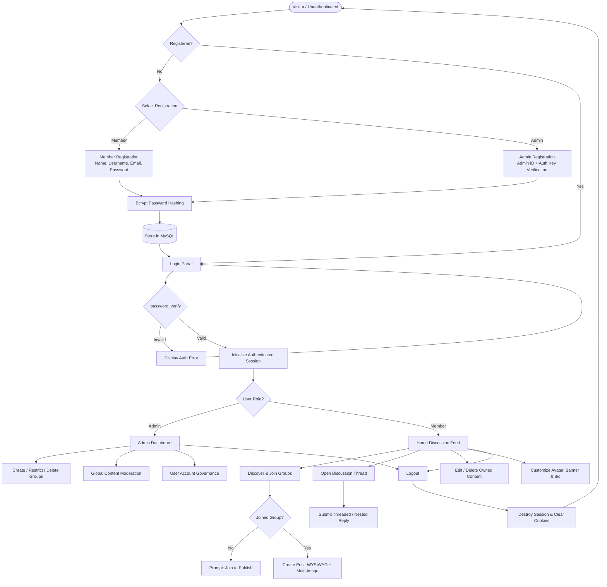
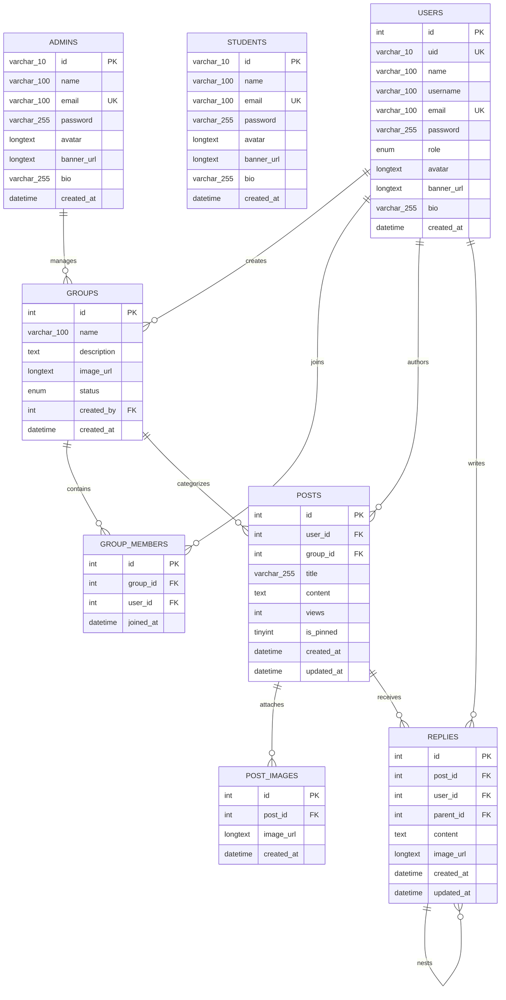

# Quaddit — Modern Discussion Forum & Community Board

<div align="center">


<br/>

[](https://www.php.net/)
[](https://www.mysql.com/)
[](https://httpd.apache.org/)
[](https://developer.mozilla.org/)
[](https://developer.mozilla.org/)
[](https://opensource.org/licenses/MIT)

<p align="center">
  A lightweight, high-performance community forum and discussion board built with <strong>pure PHP</strong> and <strong>MySQL</strong>. Featuring group-based discussion hubs, a real-time WYSIWYG rich text composer, multi-image uploads, recursive nested replies, fine-grained role-based access control (RBAC), and a responsive Twitter/X-style interface with native dark/light themes.
</p>

[Explore Features](#-key-features) • [System Architecture](#-system-architecture) • [Database Schema](#-database-design--schema) • [Installation Guide](#-installation--getting-started) • [Security](#-security--validation)

</div>

---

## 📸 Project Preview

<div align="center">

| Central Discussion Feed & Quick Composer | Group Communities Hub |
| :---: | :---: |
| <br/>*Real-time WYSIWYG composer, multi-image attachment previews, and chronological feeds* | <br/>*Subject and topic-based group catalog with one-click join/leave and member gating* |

| Administrative Control Panel | User Profile & Activity Manager |
| :---: | :---: |
| *Platform analytics, group lifecycle controls (active/restricted), and moderation tools* | *Custom 3:1 banner, profile avatar, biography, and tabbed post/reply activity history* |

</div>

---

## ⚡ Key Highlights

- **Dependency-Free Architecture**: Zero bloated frontend libraries or heavy backend frameworks. Pure PHP 8.2+ and Vanilla JavaScript for maximum speed, transparency, and minimal server footprint.
- **Role-Based Access Control (RBAC)**: Strict segregation between **Members** and **Administrators** with protected authentication gateways.
- **Group Communities**: Create topic-specific channels (e.g., *Full Stack Development*, *Software Architecture*, *Cloud Engineering*) where posting is gated to joined members.
- **Interactive Rich Composer**: In-place visual text styling (Bold, Italic, Strikethrough, Headings) with real-time active button states and safe Markdown fallback.
- **Multi-Image Attachments**: Upload up to 4 images per discussion with instant client-side preview thumbnails and one-click removal before publishing.
- **Recursive Threaded Discussions**: Unlimited nested reply hierarchy with parent-child relationship tracking and inline reply authoring.
- **Theme Flexibility**: Persistent Dark Mode and Light Mode switching with custom CSS design tokens.

---

## 🎯 Key Features by User Role

### 👥 For Public Visitors & Members
- **Seamless Onboarding**: Simple account registration with validation and encrypted credential storage.
- **Role-Isolated Login**: Clean authentication portal directing users according to account credentials.
- **Community Discovery**: Browse public groups, discover trending discussions, and view member counts.
- **Group Membership**: One-click Join/Leave actions gating discussion creation to verified group participants.
- **Rich Discussion Creation**:
  - WYSIWYG formatting toolbar with instant visual feedback (no raw Markdown tags inserted).
  - Multiple image attachments with client-side preview and individual deletion controls.
  - Post view counter automatically tracking discussion engagement.
- **Nested Conversation Threads**:
  - Reply directly to main discussions or reply recursively to existing replies.
  - Inline reply creator within feeds and dedicated thread view pages.
  - Most recent replies surfaced dynamically.
- **Content Ownership**: Authors retain full permissions to edit or permanently delete their own posts and replies.
- **Profile Customization**:
  - Custom display name and biographical summary.
  - Avatar image and custom header banner (3:1 aspect ratio).
  - Tabbed activity view: **Posts Published** vs. **Replies Authored**.

### 🛡️ For Administrators
- **Administrative Portal**: Secure, separate onboarding portal verified via administrative authorization key (`QUAD-ADMIN-2026`).
- **Real-Time Analytics Dashboard**: Overview metrics displaying Total Groups, Active Groups, Total Discussions, and Registered Accounts.
- **Group Lifecycle Management**:
  - Create new community discussion groups with custom titles and descriptions.
  - Set group status: **Active** (open to posting) or **Restricted** (read-only archive mode).
  - Modify group metadata or permanently remove obsolete groups.
- **Global Content Moderation**:
  - Authority to delete policy-violating discussions and replies across any group.
  - Creator safeguards preventing the founding administrator from abandoning created groups.
- **User Account Governance**: Roster management with capabilities to restrict or unban users.

---

## 🛠️ Technology Stack

```
┌────────────────────────────────────────────────────────────────────────┐
│                            TECHNOLOGY STACK                            │
├───────────────────┬────────────────────────────────────────────────────┤
│ Presentation Tier │ HTML5 Semantic Elements                            │
│                   │ CSS3 (Custom Variables, Flexbox, CSS Grid)         │
│                   │ Vanilla JavaScript (ES6+, DOM Manipulation, AJAX)  │
├───────────────────┼────────────────────────────────────────────────────┤
│ Application Tier  │ PHP 8.2+ (Procedural / Modular Architecture)       │
│                   │ Native Session Handler (PHP Sessions)              │
│                   │ Apache HTTP Server 2.4+                            │
├───────────────────┼────────────────────────────────────────────────────┤
│ Database Tier     │ MySQL 8.0+ / MariaDB (InnoDB Engine)               │
│                   │ PHP MySQLi Extension (Prepared Statements)         │
│                   │ phpMyAdmin (Database Management & Inspection)      │
├───────────────────┼────────────────────────────────────────────────────┤
│ Dev Environment   │ XAMPP v3.3.0+ Localhost Stack                      │
└───────────────────┴────────────────────────────────────────────────────┘
```

---

## 🔄 Application Workflow

The diagram below illustrates the complete operational lifecycle from guest onboarding to community engagement and moderation:



---

## 🏛️ System Architecture

Quaddit implements a classic **3-Tier Client-Server Architecture** ensuring clean separation of concerns:

```
┌────────────────────────────────────────────────────────────────────────┐
│                   1. PRESENTATION TIER (Client Side)                   │
│               HTML5  •  CSS3  •  Vanilla JavaScript (ES6+)             │
│   - Responsive Feed & Mobile Drawer Layout                             │
│   - Visual WYSIWYG Formatter & Active State Tracker                    │
│   - Client-side Image Previews & Dynamic Attachment Controls           │
│   - Native Light/Dark Theme Controller                                 │
└───────────────────────────────────┬────────────────────────────────────┘
                                    │ HTTP / HTTPS Requests
                                    ▼
┌────────────────────────────────────────────────────────────────────────┐
│                   2. APPLICATION TIER (Server Side)                    │
│                  PHP 8.2+  •  Apache 2.4 Web Server                    │
│   - Router & Request Dispatcher (index.php, profile.php, etc.)        │
│   - Session Governance & Role-Based Access Control (RBAC)              │
│   - XSS Filtering & Input Sanitization Engine                          │
│   - Media Processing, Multipart Upload Handling & MIME Validation      │
└───────────────────────────────────┬────────────────────────────────────┘
                                    │ MySQLi Parameterized Statements
                                    ▼
┌────────────────────────────────────────────────────────────────────────┐
│                     3. DATA TIER (Storage Layer)                       │
│                        MySQL 8.0+ (InnoDB)                             │
│   - Relational Tables (users, groups, posts, post_images, replies)     │
│   - Foreign Key Constraints & Cascading Deletions (ON DELETE CASCADE)  │
│   - UTF8mb4 Character Encoding for Universal Emoji & Symbol Support    │
└────────────────────────────────────────────────────────────────────────┘
```

---

## 🗄️ Database Design & Schema

The relational database (`quaddit`) is structured into specialized InnoDB tables enforcing referential integrity with cascading updates and deletions:



### Table Dictionary

| Table Name | Primary Key | Foreign Keys | Role & Description |
| :--- | :--- | :--- | :--- |
| **`users`** | `id` (AUTO_INCREMENT) | — | Unified relational bridge maintaining clean foreign keys across all entities without complex polymorphic joins. |
| **`students`** | `id` (VARCHAR 10) | — | Dedicated storage for member accounts with unique 10-digit account identifiers. |
| **`admins`** | `id` (VARCHAR 10) | — | Dedicated storage for system administrator accounts. |
| **`groups`** | `id` (AUTO_INCREMENT) | `created_by` → `users(id)` | Discussion categories; supports `active` and `restricted` states. |
| **`group_members`**| `id` (AUTO_INCREMENT) | `group_id`, `user_id` | Unique composite relationship (`group_id`, `user_id`) gating post creation. |
| **`posts`** | `id` (AUTO_INCREMENT) | `user_id`, `group_id` | Discussion threads with title, content, view counter, and pinned flag. |
| **`post_images`** | `id` (AUTO_INCREMENT) | `post_id` → `posts(id)` | Multi-image attachments linked to posts with cascading deletion. |
| **`replies`** | `id` (AUTO_INCREMENT) | `post_id`, `user_id`, `parent_id` | Threaded comments supporting recursive nested replies (`parent_id` self-reference). |

---

## 🔒 Security & Validation

The application incorporates multi-layered defensive engineering to protect user data and platform integrity:

```
┌────────────────────────────────────────────────────────────────────────┐
│                        SECURITY IMPLEMENTATION                         │
├──────────────────────┬─────────────────────────────────────────────────┤
│ SQL Injection        │ Parameterized Prepared Statements across 100%   │
│ Defense              │ of dynamic queries ($stmt->prepare / bind_param)│
├──────────────────────┼─────────────────────────────────────────────────┤
│ Password Cryptography│ Bcrypt hashing with random salt via PHP's native│
│                      │ password_hash($pwd, PASSWORD_BCRYPT)            │
├──────────────────────┼─────────────────────────────────────────────────┤
│ Cross-Site Scripting │ Context-aware escaping via htmlspecialchars()   │
│ (XSS) Prevention     │ and regex attribute stripping on rich content   │
├──────────────────────┼─────────────────────────────────────────────────┤
│ Access Control (RBAC)│ Strict session verification on administrative   │
│                      │ endpoints and author ownership checks on writes │
├──────────────────────┼─────────────────────────────────────────────────┤
│ File Upload Security │ Extension, MIME-type, and payload size bounds   │
│                      │ validation prior to image processing            │
├──────────────────────┼─────────────────────────────────────────────────┤
│ Database Cascades    │ Referential integrity enforced at the engine    │
│                      │ level using ON DELETE CASCADE                   │
└──────────────────────┴─────────────────────────────────────────────────┘
```

---

## 📁 Repository Directory Structure

```
FORUM-OR-DISCUSSION-BOARD/
│
├── assets/                          # Static Frontend Resources
│   ├── css/
│   │   ├── auth.css                 # Dedicated portal styling (forms, input groups, badges)
│   │   └── style.css                # Master application stylesheet (themes, cards, layout)
│   ├── js/
│   │   └── main.js                  # Client logic, WYSIWYG engine, dynamic modals & previews
│   └── images/                      # Application brand logos and default SVGs
│       ├── avatar_default.svg       # Fallback user profile avatar
│       ├── logo-dark-theme.png      # Brand mark for dark mode
│       ├── logo-light-theme.png     # Brand mark for light mode
│       └── logo-transparent.png     # Transparent brand emblem
│
├── includes/                        # Reusable Component Partials
│   └── mobile-nav.php               # Bottom navigation bar for mobile viewports
│
├── admin_register.php               # Admin onboarding router with authorization verification
├── db.php                           # Database connection gateway, session init & sanitize helpers
├── index.php                        # Master controller: Home feed, composer, group views & search
├── login.php                        # Multi-role authentication portal
├── logout.php                       # Secure session termination and redirect handler
├── profile.php                      # User profile controller, banner/avatar upload & activity
├── register.php                     # Member registration handler
├── reply.php                        # Discussion reply router and deep-link handler
├── schema.sql                       # Production DDL database schema with table definitions
├── test_auth_visibility.php         # Diagnostic utility verifying session state isolation
├── thread.php                       # Single thread permalink router
└── README.md                        # Project documentation
```

---

## 🚀 Installation & Getting Started

### Prerequisites

- [XAMPP](https://www.apachefriends.org/) (recommended) or any standalone **Apache 2.4+**, **PHP 8.2+**, and **MySQL 8.0+** environment.
- Web Browser (Chrome, Firefox, Safari, Edge).
- Git installed on your system.

### Step-by-Step Setup

#### 1. Clone the Repository
Clone this repository directly into your local web root directory (for XAMPP on Windows, use `htdocs`):

```bash
cd C:\xampp\htdocs
git clone https://github.com/your-username/FORUM-OR-DISCUSSION-BOARD.git
```

#### 2. Start Web & Database Services
Launch the **XAMPP Control Panel** and start:
- **Apache** (Default ports: `80`, `443`)
- **MySQL** (Default port: `3306`)

#### 3. Import the Database Schema
1. Open your browser and navigate to phpMyAdmin:
   ```
   http://localhost/phpmyadmin/
   ```
2. Click on the **Import** tab in the top navigation bar.
3. Click **Choose File** and select the [`schema.sql`](./schema.sql) file located in the project root directory.
4. Click **Import** (or **Go**).
5. The database `quaddit` and all required tables (`users`, `admins`, `students`, `groups`, `group_members`, `posts`, `post_images`, `replies`) will be created automatically.

#### 4. Configure Database Connection (Optional)
If your local MySQL uses a custom port, password, or host, adjust settings in [`db.php`](./db.php):

```php
$conn = new mysqli('127.0.0.1', 'root', 'your_password', 'quaddit', 3306);
```

#### 5. Launch the Application
Open your browser and navigate to:
```
http://localhost/FORUM-OR-DISCUSSION-BOARD/
```

#### 6. Admin Account Setup
To create your first system administrator account:
1. Navigate to: `http://localhost/FORUM-OR-DISCUSSION-BOARD/admin_register.php`
2. Enter your details and provide the administrative authorization key:
   ```
   QUAD-ADMIN-2026
   ```
3. Complete registration and access the administrative dashboard.

---

## 🗺️ Roadmap & Future Enhancements

- [ ] **Real-Time WebSockets**: Instant message and comment streaming using Ratchet PHP / Socket.io without page reload.
- [ ] **Full-Text Search Engine**: Replace standard SQL `LIKE` queries with indexed full-text search (MeiliSearch or Elasticsearch).
- [ ] **OAuth2 & Social Logins**: One-click authentication with Google and GitHub.
- [ ] **Direct Private Messaging**: End-to-end encrypted 1-on-1 conversations between community members.
- [ ] **Markdown Code Syntax Highlighting**: Integrated Prism.js / Highlight.js for code snippets in technical discussions.
- [ ] **RESTful API & Mobile Client**: Decoupled JSON REST API powering native iOS and Android mobile apps.

---

## 🤝 Contributing

Contributions, issues, and feature requests are welcome! Feel free to check the issues page or submit a pull request:

1. **Fork the Project**
2. **Create your Feature Branch**: `git checkout -b feature/AmazingFeature`
3. **Commit your Changes**: `git commit -m 'Add some AmazingFeature'`
4. **Push to the Branch**: `git push origin feature/AmazingFeature`
5. **Open a Pull Request**

---

## 📄 License

This project is open-source and available under the **[MIT License](https://opensource.org/licenses/MIT)**.

---

<div align="center">
  <sub>Built with ❤️ using pure PHP, MySQL, and modern Vanilla Web Standards.</sub>
</div>
